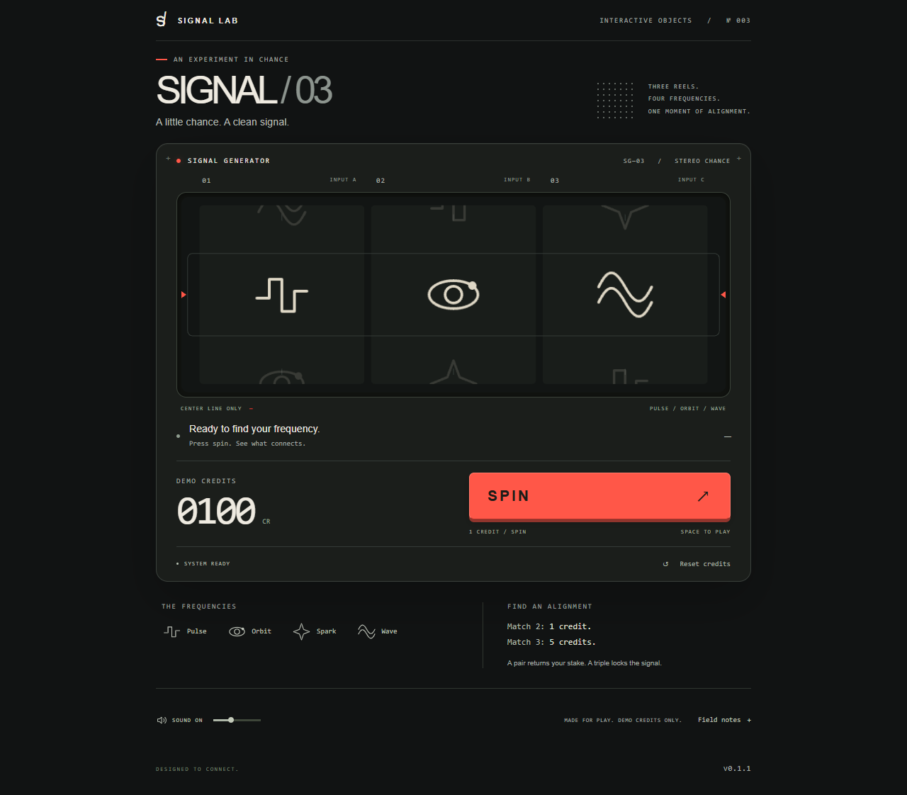

# SIGNAL / 03

A tiny electronic instrument disguised as a slot machine. Original procedural graphics, native synthesized sound, and one obvious red key.

**[Source repository](https://github.com/KainthAbhinandan/signal-03)** · **Public demo: pending Cloudflare sign-in and URL verification.** See [release status](docs/RELEASE_STATUS.md) for current links and the recording status. Do not send a localhost URL to other people.



## Run locally

Requires Node.js **24.14+** and npm. `.node-version` pins **24.14.0** for local/Cloudflare builds. From this folder:

```sh
npm ci
npm run dev
```

Open **http://127.0.0.1:5173**. If that port is occupied, use `npm run dev -- --port 5174`. On Windows PowerShell, use `npm.cmd` if the execution policy blocks `npm.ps1`.

```sh
npm run verify     # strict types, unit tests, production build
npm run preview    # serve dist/ at http://127.0.0.1:4173
```

Vite copies everything needed into `dist/`. Serve that directory over HTTP; opening index.html directly from the filesystem is not supported. `base: './'` allows hosting under a subdirectory.

## Free hosting and release version

Deploy this static application on Cloudflare Pages Free with **build command `npm run build`** and **output directory `dist`**. [Deployment instructions](docs/DEPLOYMENT.md) cover GitHub connection, repository layout, Node setup, public verification and updates. Players need no account or API key, and runtime assets are served with the game.

The footer displays the package.json version, injected by Vite at build time. Include that label in full-page screenshots and copy it into bug reports, alongside the URL, browser/device, steps and expected/actual behavior. See [CHANGELOG.md](CHANGELOG.md) for release history and the patch/minor/1.0.0 policy. `npm version patch --no-git-tag-version` updates package metadata and the lockfile together; rebuild and redeploy to update the public label.

## Play

- Start with 100 demo credits. Press **SPIN**, or **Space** outside another control.
- Each spin costs 1 credit. Only the three center symbols count.
- Match exactly two anywhere: **1 credit awarded** (stake returned). Match three: **5 credits awarded**. Otherwise: 0.
- Awards are added after the cost. A triple takes a starting balance of 100 to 104.
- Reset restores 100 credits when idle. It is available immediately at zero credits.
- Sound starts through a gesture. Mute and volume are saved; the credit balance is not.

No real money, wagers, autoplay, bonus rounds or server. Normal results use three independent, uniform cryptographic draws. Reels reveal the result already selected by the controller.

## Code map

- `src/domain/`: symbol IDs, sampling, immutable outcomes and payouts. No rendering, DOM or sound imports.
- `src/app/GameController.ts`: guarded spin transaction and state transitions.
- `src/app/createGame.ts`: composition and browser lifecycle ownership.
- `src/rendering/`: cached symbols, masked reels, effect pool and one Pixi ticker.
- `src/audio/AudioController.ts`: gesture-created Web Audio graph and short sound recipes.
- `src/ui/`: semantic controls, announcements, preferences and HTML shell.
- `src/config/`: palette and motion vocabulary.

Dependencies are exact-pinned: PixiJS 8.22.0, TypeScript 7.0.2, Vite 8.3.5, Vitest 5.0.5. Agent-browser 0.39.2 is a development verification tool. `package-lock.json` records the full dependency graph. No runtime imagery, remote assets or font downloads.

## Development previews and verification

The collapsible **DEVELOPMENT ONLY / RESULT PREVIEW** panel at the bottom previews a miss, a separated pair, and a triple. Normal SPIN retains its original probabilities. `?dev-credits=0` provides a zero-credit fixture. Vite eliminates this module, its diagnostic getter, fixtures and controls from production.

The 85 Vitest cases exhaust all 64 outcomes and cover immutable sampling, invalid random input, accounting, busy input, reset, zero credits, failures and teardown races. Browser checks were also run in real Chrome at desktop, 390px and 320px widths; see [verification evidence](docs/VERIFICATION.md). A reusable core browser assertion script is in `tests/browser-check.js`:

```powershell
# With the dev server already running and Chrome installed:
npx agent-browser --session signal03 open http://127.0.0.1:5173
Get-Content -Raw tests/browser-check.js | npx agent-browser --session signal03 eval --stdin
npx agent-browser --session signal03 screenshot --full
npx agent-browser --session signal03 close
```

On a clean machine, run `npx agent-browser install` to install its browser, or pass `--executable-path` for an existing Chrome installation. The browser assertion script expects the default sound preference; clear this origin's stored preferences before replaying it if mute was changed previously. Browser checks are separate from `npm run verify`.

## Before presenting

Start with the [case study](docs/CASE_STUDY.md), [five-minute playtest plan](docs/PLAYTEST.md), [30-second demo script](docs/DEMO_SCRIPT.md), and [sourced outreach drafts](docs/OUTREACH.md). No messages or applications have been sent; no feedback or publisher interest is claimed.

1. [Interview walkthrough](docs/INTERVIEW_WALKTHROUGH.md): product pitch, five-minute code tour, likely questions and tradeoffs.
2. [Architecture](docs/ARCHITECTURE.md): trace one spin and understand ownership.
3. [Verification](docs/VERIFICATION.md): exact evidence and limits.
4. [Art direction](docs/ART_DIRECTION.md) and [assets](docs/ASSETS.md): visual and audio decisions.

## Authorship and license

Built with **substantial AI assistance**, including implementation, procedural geometry/sound code, documentation and verification scripts. The owner directs, reviews and is learning to explain the work; this is not a claim of unaided authorship, professional experience or commercial player validation.

The owner explicitly chose to retain **MIT** for project-authored code, geometry and sound recipes. Dependency rights remain separate. Every build generates [third-party runtime notices](public/THIRD_PARTY_NOTICES.txt) and copies them into dist/. This is a portfolio prototype, not a certified gambling product.
